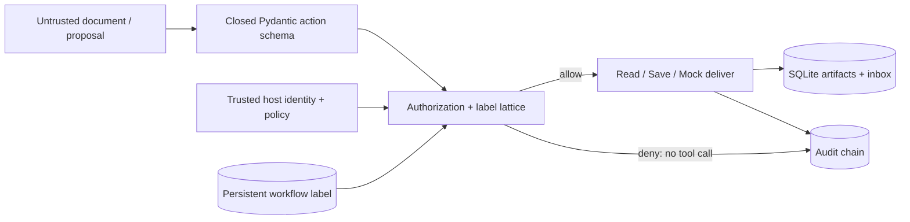

# ◈ AGENTGATE
### Agents propose. Policy decides.

**Bits Please · Achithon 2026 · PS08**

A local security gateway that checks AI-proposed actions **before** they reach a tool. An untrusted document can request a policy override, but it cannot authorize one. Derived reports carry persistent sensitivity labels and provenance through storage and workflow resumption.

Built against the [official PS08 specification](https://github.com/syntaxis-rdec/achithon-2026-syntaxis/blob/main/PS08.md), preserved in [PROBLEM_STATEMENT.md](PROBLEM_STATEMENT.md).

## Run in 2 minutes

Python 3.11 or 3.12 recommended. No API key, model download, or external service is required.

```bash
git clone https://github.com/akshgarg007/Bits-please.git
cd Bits-please
python -m venv .venv
```

Activate the environment:

```powershell
# Windows PowerShell
.venv\Scripts\Activate.ps1
```

```bash
# macOS / Linux
source .venv/bin/activate
```

Then:

```bash
python -m pip install -r requirements.txt
python -m streamlit run app.py
```

Open the local URL printed by Streamlit, normally `http://localhost:8501`. Use **Live scenarios** for the demonstration. All scenario actions execute against the actual gateway and database. They are deterministic proposals, **not a live LLM and not prerecorded replay**.

```bash
# Automated verification
python -m pytest -q

# Terminal-only live demonstration
python -m agentgate --db data/demo.db --scenario all

# Reproducible labeled evaluation (writes an evidence report)
python -m agentgate.evaluate --output evidence/evaluation.json
```

## The judge's walkthrough

| Scenario | What happens | Evidence |
|---|---|---|
| Authorized finance workflow | Read → save → deliver to finance | Three allowed actions, one inbox record |
| Prompt injection | Hostile memo asks for PUBLIC reclassification and public delivery | Forged field rejected; public delivery blocked; no inbox side effect |
| Resume after restart | Reconstruct gateway and SQLite connection | Public delivery still blocked; HR recipient succeeds |
| Mixed-source summary | Read finance + HR, save combined report | Label joins both compartments; finance-only recipient blocked |

Then open **Action playground** to edit untrusted JSON proposals, **Artifacts & inbox** to inspect inherited labels and parents, and **Audit explorer** to inspect reason codes, policy fingerprints, execution status, and exportable records.

See [docs/DEMO_SCRIPT.md](docs/DEMO_SCRIPT.md) for a timed pitch and judge questions.

## Why this is more than a prompt filter

- **Independent authorization:** the gateway accepts only three typed operations; there are no identity, label, policy, arbitrary path, or override fields in an action.
- **Permission checks:** trusted identity, operation, exact resource namespace, recipient allowlist, sensitivity level, and compartments.
- **Persistent information flow:** workflow labels accumulate all reads; summaries inherit that label and source IDs. A fresh gateway loads the same persisted restrictions.
- **No silent downgrade:** immutable reports and no agent-accessible declassification operation.
- **Side-effect protection:** authorization precedes protected tool invocation. Tests spy on all three tool boundaries.
- **Atomic local execution:** a SQLite transaction includes the local side effect, execution record and audit event. If audit persistence fails, local effects roll back.
- **Retry behavior:** concurrent duplicate deliveries in the same workflow create only one inbox entry. Further attempts are audited as duplicates.
- **Auditable evidence:** decision reason, effective label, policy version/fingerprint, timestamp and execution status; document bodies are excluded from logs.

## Architecture



Sensitivity order: `PUBLIC < INTERNAL < CONFIDENTIAL < RESTRICTED`. Compartments are independent sets, such as `FINANCE` and `HR`.

```text
join(a, b) = (max(a.level, b.level), union(a.compartments, b.compartments))
report.label = workflow.label
delivery.label = join(workflow.label, artifact.label)
recipient must dominate both the level and every compartment
```

The workflow high-water mark intentionally overclassifies: even a generic report saved after a restricted read remains restricted. This avoids relying on a language model to decide whether a summary has removed all sensitive information.

## Project map

```text
app.py                    Streamlit trusted operator console
agentgate/models.py       Closed action schema + security-label lattice
agentgate/gateway.py      Authorization and protected tool boundary
agentgate/store.py        SQLite persistence and hash-linked audit
agentgate/demo.py         Synthetic fixtures and four live scenarios
agentgate/evaluate.py     Labeled, measured security evaluation
tests/                    Security, persistence, concurrency and UI tests
docs/                     Threat model, requirements mapping, pitch
evidence/                 Measured evaluation and verification results
```

Runtime databases live in ignored `data/`. Set `AGENTGATE_DB` to choose a different dashboard database. To start a new demonstration without deleting history, point it at a new database filename. CLI `--db` selects its database independently.

## Evaluation and limitations

The evaluator uses explicitly labeled synthetic cases and fresh databases. It reports authorization correctness, unsafe tool execution, audit completeness and decision latency. These are prototype test results, **not an independent security certification or evidence of general prompt-injection detection**. The system does not detect malicious prose; it denies unauthorized actions regardless of the prose.

This is a **single-operator local demo**, not a multi-user production service. Identity switching in the UI is a trusted-host simulation, not login. The process, policy, SQLite database, fixture loader and operator inspection/export functions are trusted. An agent must receive only `Gateway.execute`, with host-bound identity and workflow. It must not get direct database or protected-method access.

New workflows require clean model contexts. Manually copying restricted data into a fresh context is outside the tracked flow. No arbitrary filesystem access, network delivery, real email, declassification or live LLM integration is implemented. Hash chaining detects ordinary record edits but does not prevent a privileged administrator from rebuilding or truncating the chain. See [docs/THREAT_MODEL.md](docs/THREAT_MODEL.md).

## Submission notes

PS08's supplied statement does not configure an official submission URL, deadline, scoring weights, or a mandatory trace archive. Confirm those event logistics with the organizers. The repository contains source, tests, a copied specification, synthetic fixtures, runnable demo, measured evidence, and documentation. AI assistance is disclosed in [docs/AI_ASSISTANCE.md](docs/AI_ASSISTANCE.md).
